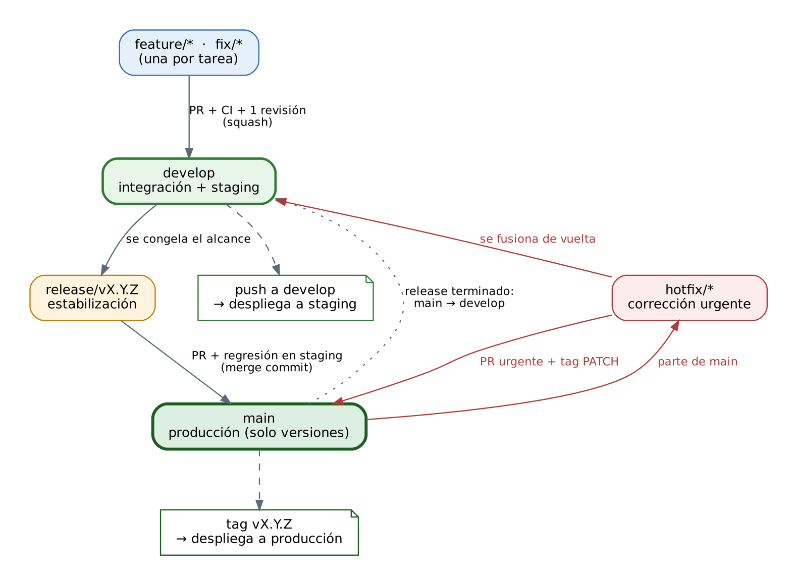
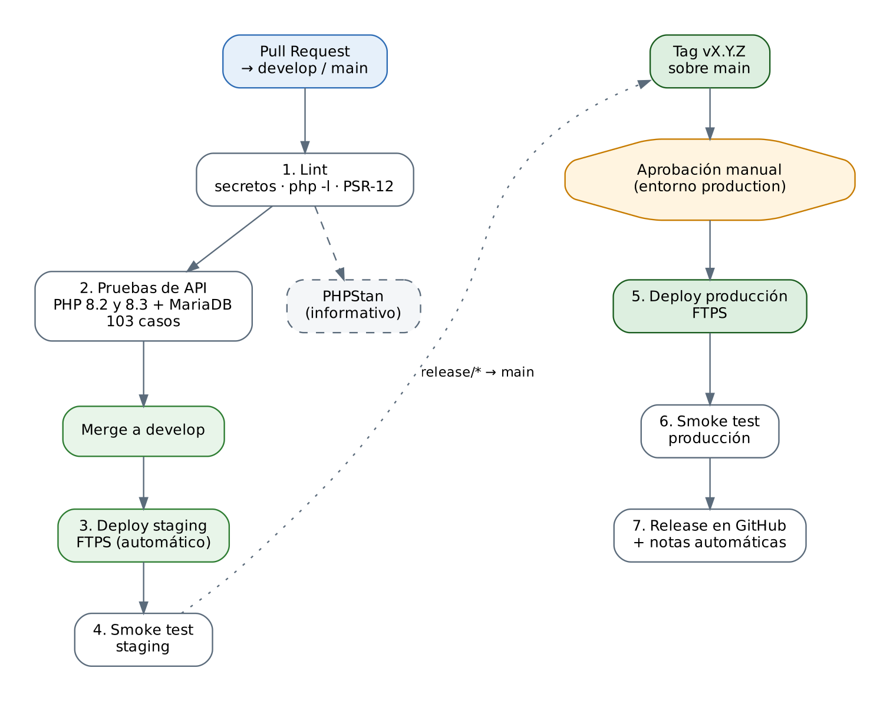

# 1. Parámetros de configuración de las herramientas utilizadas

*Control de Bandas es una aplicación web, desarrollada en PHP con base de datos MySQL/MariaDB, que permite asignar viajes a operadores, llevar el inventario de bandas de sujeción de las nodrizas y registrar la firma de conformidad desde el celular. Se publica en un hosting de Hostinger.*

En esta sección se describen las herramientas elegidas para gestionar el proyecto y cómo se configuró cada una, junto con la razón de cada decisión.

## 1.1 Herramientas utilizadas

| Herramienta | Versión | Para qué se usa |
|:------------------------|:------------------------|:---------------------------------------------|
| Git y GitHub | Git 2.x | Guardar el historial del código y trabajar en equipo mediante *pull requests* (solicitudes de cambio) |
| PHP | 8.2 en el hosting; 8.2 y 8.3 en las pruebas | Lenguaje de la aplicación |
| MariaDB | 10.11 | Base de datos (compatible con MySQL) |
| Apache | El de Hostinger | Servidor web; su archivo `.htaccess` protege los archivos internos |
| PHPUnit | 10.5 / 11 | Pruebas automáticas |
| PHP_CodeSniffer y PHPStan | Estándar PSR-12 / nivel 3 | Revisar el estilo y detectar errores en el código |
| GitHub Actions | — | Ejecutar pruebas y publicar el sitio de forma automática (CI/CD) |
| Docker Compose | v2 | Crear un entorno local igual al del hosting |

## 1.2 Git y GitHub

| Aspecto | Configuración | Razón |
|:----------------------------|:------------------------------------------|:-----------------------------------|
| Ramas principales | `main` (producción) y `develop` (integración) | Separar lo estable de lo que está en desarrollo |
| Protección de ramas | Los cambios solo entran con *pull request*, una aprobación y las pruebas en verde; no se permite borrar la rama ni forzar cambios | Evitar errores y cambios sin revisar |
| Revisores | Archivo `CODEOWNERS` para las partes sensibles (configuración, base de datos, flujos de GitHub) | Que alguien responsable revise lo delicado |
| Seguridad de la cuenta | Verificación en dos pasos, detección de contraseñas subidas por error y alertas de Dependabot | Proteger el repositorio |
| Entornos de GitHub | `staging` (automático) y `production` (requiere aprobación manual) | Evitar que algo llegue a producción sin que alguien lo autorice |
| Hooks de Git | Revisan el formato del mensaje de cada commit y buscan contraseñas antes de guardarlo | Detectar problemas desde el equipo del desarrollador |

## 1.3 Servidor y lenguaje

| Aspecto | Configuración | Razón |
|:----------------------------|:------------------------------------------|:-----------------------------------|
| Versión de PHP | 8.2 | Es la que se prueba en las pruebas automáticas |
| Zona horaria | `America/Hermosillo` (también en la base de datos) | Que las fechas de los viajes sean correctas |
| Manejo de errores | No se muestran al público; se guardan en un registro | No revelar información interna |
| Sesión de usuario | Cookie protegida (`HttpOnly`, `SameSite`, `Secure`); duración sugerida de 8 horas | Evitar robo de sesión y que un operador pierda su sesión a mitad del turno |
| Protección de archivos | El `.htaccess` fuerza HTTPS, oculta el listado de carpetas y bloquea el acceso directo a archivos internos y a las fotos | Que solo se pueda entrar por la aplicación |
| Fotos y firmas | Se guardan en una carpeta bloqueada; solo se entregan a usuarios con sesión | Proteger la evidencia |

## 1.4 Base de datos

| Aspecto | Configuración | Razón |
|:----------------------------|:------------------------------------------|:-----------------------------------|
| Motor | InnoDB | Permite transacciones: si una operación falla, no se guarda a medias |
| Caracteres | `utf8mb4` | Acentos y símbolos en nombres y notas |
| Permisos | El usuario de la aplicación solo puede leer y escribir datos; otro usuario puede modificar la estructura | Mínimo privilegio |
| Cambios de estructura | Archivos numerados en `database/migrations/`, aplicados con `bin/migrate.php` | Tener historial y repetir lo mismo en todos los entornos |

El esquema inicial se reconstruyó a partir del código porque el proyecto original no lo incluía; antes de usarlo en producción debe compararse con la base real.

## 1.5 Calidad, pruebas y automatización

| Aspecto | Configuración |
|:----------------------------|:---------------------------------------------------------------|
| Pruebas | PHPUnit con pruebas que usan la aplicación como lo haría un usuario (por la API) y una base de datos real de prueba. El script `bin/run-api-tests.sh` se niega a correr en una base cuyo nombre no indique que es de pruebas |
| Integración continua | En cada solicitud de cambio, GitHub Actions revisa la sintaxis y las contraseñas, y ejecuta las pruebas en PHP 8.2 y 8.3 |
| Despliegue automático | `develop` se publica sola en staging; `main` se publica en producción al crear una etiqueta de versión y con aprobación |
| Entorno local | Con `make up` se levanta la aplicación en `localhost:8080` con su base de datos y phpMyAdmin |

## 1.6 Hosting y manejo de secretos

| Elemento | Configuración |
|:----------------------|:-----------------------------------------------------------|
| Hostinger | Dos sitios independientes: producción y staging, cada uno con su base de datos |
| Publicación | Por FTPS (FTP cifrado) con una cuenta limitada a la carpeta del sitio |
| Contraseñas | La conexión a la base de datos va en `config.local.php`, que se crea a mano en cada servidor y **nunca se sube a Git**. Los datos del FTP viven como secretos de GitHub |
| **Pendiente importante** | El archivo original traía la contraseña de la base de datos escrita en el código y ese archivo ya circuló. Debe **cambiarse en hPanel** |

# 2. Plan de pruebas

*Basado en el estándar IEEE 829 / ISO 29119, adaptado al tamaño del proyecto.*

## 2.1 Objetivos y alcance

Las pruebas buscan que el sistema funcione como se espera y, sobre todo, que no falle en lo más delicado:

1. Que el **inventario** nunca quede en negativo ni se descuente a medias.
2. Que cada usuario solo vea y haga lo que le corresponde (**control de acceso**).
3. Que no se filtren **contraseñas ni fotos** a personas no autorizadas.
4. Que un cambio nuevo no rompa lo que ya funcionaba (**regresión**).

| Qué se prueba | Cómo |
|:----------------------------------------------------|:-------------------------|
| Inicio de sesión, usuarios, inventario, viajes, avisos, reportes, fotos y firmas | Pruebas automáticas |
| Pantallas y protección del servidor | Pruebas manuales |
| Despliegue, migraciones y respaldos | Ensayos en staging |

No se incluyen en esta fase las pruebas automáticas de la interfaz, las de carga (el volumen de uso es bajo) ni las pruebas de penetración profesionales.

## 2.2 Estrategia

| Nivel | Qué comprueba | Cuándo |
|:--------------------|:---------------------------------------------|:-----------------------------|
| Pruebas automáticas de API | Reglas del negocio y seguridad con la aplicación y la base de datos reales | En cada cambio y antes de cada despliegue |
| Prueba de humo (*smoke test*) | Que el sitio publicado abre y está protegido | Después de cada despliegue |
| Pruebas manuales | Pantallas, uso en celular, protección del servidor | Antes de cada versión |
| Pruebas de aceptación | Que usuarios reales puedan hacer su trabajo | Antes del primer lanzamiento |

Para diseñar los casos se usaron técnicas conocidas: **clases de equivalencia** (datos válidos e inválidos), **valores límite** (por ejemplo 0, −1 y 10 000 bandas), **transiciones de estado** (el ciclo de vida de un viaje) y **búsqueda de errores** (intentos de inyección SQL o archivos maliciosos).

## 2.3 Entornos y datos

| Entorno | Uso | Datos |
|:----------------|:------------------------------------------|:--------------------------------------|
| Local y CI | Pruebas automáticas | Datos de ejemplo creados antes de cada prueba (un administrador, dos operadores y dos nodrizas) |
| Staging | Pruebas manuales y ensayo de migraciones | Copia de producción **sin datos personales reales** |
| Producción | Solo la prueba de humo | Datos reales; nunca se hacen pruebas que los modifiquen |

## 2.4 Criterios de entrada y de salida

| Momento | Criterio |
|:---------------------|:--------------------------------------------------------------|
| **Para empezar a probar** | Las pruebas automáticas de `develop` pasan y staging está publicado y funcionando |
| **Para publicar una versión** | 100 % de los casos de prioridad alta (P1) aprobados; al menos 95 % de los P2; ningún defecto crítico o alto abierto; respaldo realizado |
| **Para detener las pruebas** | Falla la prueba de humo o más del 30 % de los casos quedan bloqueados por un mismo defecto |

## 2.5 Gestión de defectos

Los defectos se registran como *issues* en GitHub y, una vez corregidos, se agrega una prueba automática que lo reproduzca para que no vuelva a ocurrir.

| Severidad | Descripción | Atención |
|:-----------|:-----------------------------------------------------|:---------------------------|
| Crítica | El sistema no funciona, se pierden datos o hay fuga de seguridad | Corrección urgente el mismo día |
| Alta | Un flujo principal no se puede completar | Antes de la siguiente versión |
| Media | Existe otra forma de lograr lo mismo | En el siguiente ciclo |
| Baja | Detalle visual o de redacción | Cuando sea conveniente |

# 3. Casos de prueba

## 3.1 Convenciones

Cada caso tiene un identificador `CP-<módulo>-<número>` y una prioridad: **P1** (crítico), **P2** (importante) y **P3** (menor). En el proyecto existen **103 casos automáticos** y **26 manuales**; aquí se presentan los más importantes. Los automáticos están en la carpeta `tests/Api/` y, en la última ejecución, los 103 se aprobaron. En los casos, *A* es el administrador y *O1* y *O2* son operadores.

## 3.2 Casos automáticos

| ID | Descripción | Resultado esperado |
|:-------------|:-------------------------------------------------|:---------------------------------------------|
| CP-AUT-01 | Iniciar sesión con datos correctos | Acceso con el rol correcto |
| CP-AUT-03 | Contraseña incorrecta o usuario inexistente | Mismo mensaje de error en ambos casos |
| CP-AUT-06 | Seis intentos fallidos seguidos | Se bloquea el acceso temporalmente |
| CP-AUT-07 | Usuario desactivado intenta entrar | Se rechaza |
| CP-AUT-10 | Cerrar sesión | Ya no se puede usar el sistema sin volver a entrar |
| CP-AUT-11 | Inyección SQL en el inicio de sesión | No se obtiene acceso |
| CP-ACC-01 | Usar el sistema sin haber iniciado sesión | Acceso denegado |
| CP-ACC-02 | Un operador intenta usar inventario, usuarios o reportes | Acceso denegado; no se crea nada |
| CP-ACC-06 | O2 intenta aceptar el viaje de O1 | Se rechaza: «Este viaje no es tuyo» |
| CP-ACC-07 | O2 intenta ver la foto de un viaje de O1 | No encontrado |
| CP-USR-03 | Crear un usuario con un rol inventado | Se rechaza: «Rol no válido» |
| CP-INV-05 | Ajuste manual de inventario de 10 a 20 con motivo | Total actualizado y registro en la bitácora |
| CP-INV-06 | Ajuste con valores inválidos (−1, 10 000, letras) | Se rechaza; el inventario no cambia |
| CP-INV-10 | Sacar 500 bandas cuando solo hay 100 | Se rechaza; nunca hay existencias negativas |
| CP-INV-14 | Transferir bandas a una nodriza que no existe | Falla y todo queda como estaba |
| CP-INV-18 | Carga masiva con un dato inválido | No se aplica nada (todo o nada) |
| CP-VIA-01 | Importar un viaje con 2 nodrizas BRONCO | Se crea asignado y requiere 8 bandas |
| CP-VIA-07 | Contar bandas sin haber aceptado el viaje | Se rechaza: «Primero acepta la asignación» |
| CP-VIA-09 | Contar menos bandas que el sistema, sin foto | Se rechaza y se pide una foto como evidencia |
| CP-VIA-10 | Contar menos bandas que el sistema, con foto | Se acepta y el inventario se actualiza con bitácora |
| CP-VIA-18 | Aprobar una solicitud de 4 bandas desde el almacén | Se descuenta del almacén, se suma a la nodriza y se avisa al operador |
| CP-VIA-19 | Aprobar con solo 2 bandas en el almacén | Falla, no cambia nada y la solicitud sigue pendiente |
| CP-VIA-26 | Firmar con una firma válida | El viaje queda confirmado |
| CP-VIA-27 | Firmar con un archivo que no es una firma | Se rechaza: «La firma no es válida» |
| CP-VIA-28 | Modificar un viaje ya firmado | Se rechaza en todas las acciones |
| CP-VIA-36 | Flujo completo: asignar, aceptar, contar, solicitar, aprobar y firmar | Totales e historial consistentes |
| CP-REP-04 | Un viaje con conteo distinto al del sistema | Aparece en el reporte de discrepancias |
| CP-FOT-01 | Subir como foto un archivo que no es imagen | Se rechaza |
| CP-FOT-05 | Foto con código malicioso oculto | El código se elimina al guardar la imagen |
| CP-FOT-07 | Pedir una foto con una ruta como `../../config.php` | No se entrega ningún archivo |

## 3.3 Casos manuales

| ID | Descripción y pasos | Resultado esperado | P |
|:-------------|:----------------------------------------------|:---------------------------------|:----|
| CP-UI-01 | Abrir el sitio; probar con datos incorrectos y luego correctos | Muestra el error y después entra | P1 |
| CP-UI-03 | Importar asignaciones pegando filas copiadas de Excel | Se crean los viajes; los errores se indican por fila | P1 |
| CP-UI-05 | Como operador en celular: aceptar, contar, tomar foto, solicitar y firmar | Cada paso habilita el siguiente | P1 |
| CP-UI-07 | Firmar con un trazo muy corto y después con una firma completa | El trazo corto no se envía | P1 |
| CP-UI-12 | Crear un usuario cuyo nombre sea código HTML | Se muestra como texto y no se ejecuta | P1 |
| CP-SEG-01 | Escribir en el navegador la dirección de `db.php`, `lib.php` o `config.php` | Acceso denegado | P1 |
| CP-SEG-02 | Abrir la carpeta de fotos o una foto directamente | Acceso denegado | P1 |
| CP-SEG-03 | Abrir el sitio con `http://` | Redirige a `https://` | P1 |
| CP-SEG-05 | Cambiar la contraseña de la base de datos y actualizar la configuración | La aplicación funciona; la contraseña anterior ya no sirve | P1 |
| CP-CON-01 | Dos administradores aprueban la misma solicitud al mismo tiempo | Solo se aplica una vez | P1 |
| CP-DEP-01 | Ejecutar la prueba de humo contra staging | Termina con «SMOKE TEST OK» | P1 |
| CP-DEP-02 | Aplicar las migraciones sobre una copia de producción | Sin errores y sin perder datos | P1 |
| CP-DEP-03 | Volver a la versión anterior (*rollback*) | El sitio regresa a la versión anterior y se mide el tiempo | P1 |
| CP-UAT-01 | Un operador real completa un viaje con supervisión | Lo logra sin ayuda y el total coincide con el conteo físico | P1 |
| CP-UI-11 | Probar la pantalla en anchos de celular, tableta y computadora | Se ve bien sin desplazamiento lateral | P2 |
| CP-COM-01 | Repetir el flujo básico en Chrome, Edge, Firefox y Safari | Mismo resultado | P2 |

# 4. Flujo de trabajo para el control de versiones

## 4.1 Estrategia y ramas

Se eligió **Git Flow simplificado**, porque el sistema se publica por versiones y se cuenta con un entorno de pruebas (staging). Hay dos ramas permanentes y ramas temporales para cada tarea.

{width=70%}

| Rama | Para qué sirve | Se fusiona en |
|:-------------------------|:------------------------------------------------|:----------------------|
| `main` | Código en producción; solo recibe versiones terminadas | — |
| `develop` | Integración de lo nuevo; se publica en staging | — |
| `feature/<tarea>` | Una funcionalidad nueva | `develop` |
| `fix/<tarea>` | Una corrección que no es urgente | `develop` |
| `release/vX.Y.Z` | Preparar y probar una versión antes de publicarla | `main` y `develop` |
| `hotfix/<tarea>` | Corrección urgente de un error en producción | `main` y `develop` |

## 4.2 Mensajes de commit y versiones

Los mensajes siguen el estándar **Conventional Commits**: `tipo(área): descripción corta`. Los tipos principales son `feat` (funcionalidad nueva), `fix` (corrección), `docs`, `test` y `chore`. Ejemplo: `feat(viajes): permite cancelar una solicitud pendiente`. Un hook de Git rechaza los mensajes que no cumplan el formato.

Las versiones usan **versionado semántico** (`vMAYOR.MENOR.PARCHE`): se sube el *mayor* si el cambio es incompatible, el *menor* si se agrega una funcionalidad y el *parche* si solo se corrige un error. Los cambios de cada versión se anotan en `CHANGELOG.md`.

## 4.3 Revisión de cambios (pull requests)

- Todo cambio entra mediante un *pull request* con una plantilla que explica qué cambia, cómo se probó y cómo revertirlo.
- Para fusionarlo deben pasar las pruebas automáticas y recibir al menos una aprobación.
- Quien revisa verifica que exista una prueba para el cambio, que no haya contraseñas en el código y que los cambios a la base de datos no rompan lo existente.
- Las ramas de trabajo se fusionan con *squash* (un solo commit limpio) y se borran al terminar.

## 4.4 Procedimientos

1. **Nueva funcionalidad:** crear la rama `feature/...` desde `develop`, programar junto con su prueba, correr las pruebas y abrir el *pull request*.
2. **Nueva versión:** crear `release/vX.Y.Z`, probarla en staging, fusionarla en `main` y crear la etiqueta `vX.Y.Z`, que dispara el despliegue a producción; después se regresan los cambios a `develop`.
3. **Error urgente (*hotfix*):** crear la rama desde `main`, escribir primero la prueba que reproduce el error, corregirlo y publicar una versión de parche.
4. **Contraseña subida por error:** se considera comprometida, por lo que se cambia de inmediato y solo después se limpia el historial.

# 5. Estrategia de despliegue

## 5.1 Entornos y pipeline

Se publica por **versiones completas en una ventana de poco uso**, siempre pasando antes por staging. Dado el tamaño del sistema no se justifican estrategias más complejas como *canary* o *blue/green*.

| Entorno | Cuándo se publica | Aprobación |
|:----------------|:---------------------------------------------|:----------------------|
| Local | Con `make up`, para desarrollar | — |
| Staging | Al fusionar en `develop` o `release/*` | Automática |
| Producción | Al crear la etiqueta `vX.Y.Z` | Manual, por el responsable de TI |

{width=70%}

| Paso del pipeline | Qué hace |
|:----------------------------|:-----------------------------------------------------------|
| 1. Revisión de código | Comprueba sintaxis, estilo y que no haya contraseñas |
| 2. Pruebas automáticas | Ejecuta los 103 casos en PHP 8.2 y 8.3; si alguno falla, se detiene |
| 3. Aprobación | Una persona autoriza la publicación en producción |
| 4. Subida por FTPS | Publica solo la carpeta `public_html/`; no sube contraseñas, fotos ni pruebas |
| 5. Prueba de humo | Verifica que el sitio abra y esté protegido; si falla, se hace *rollback* |

## 5.2 Base de datos

Los cambios a la base de datos se hacen con **migraciones**: archivos numerados que nunca se editan una vez aplicados y que deben ser compatibles con la versión anterior del código. Antes de migrar en producción se hace un respaldo y se ensaya el cambio en staging con una copia reciente. El orden en cada versión es: respaldo, migración, publicación del código, prueba de humo y revisión manual.

## 5.3 Verificación posterior

La prueba de humo (`bin/smoke-test.sh`) no inicia sesión ni modifica datos; comprueba que la página principal abre, que la conexión con la base de datos funciona, que las funciones privadas exigen sesión, que los archivos internos y las fotos están bloqueados y que `http://` redirige a `https://`. Después se revisa manualmente durante unos 30 minutos: entrar como administrador y como operador, recorrer un viaje de prueba y revisar el registro de errores en hPanel.

## 5.4 *Rollback* y respaldos

| Situación | Acción | Tiempo objetivo |
|:----------------------------------------------|:------------------------------------------------|:-------------|
| La prueba de humo falla o hay un error grave | Volver a publicar la etiqueta de la versión anterior | ≈ 15 min |
| La versión incluía una migración | Lo anterior y restaurar el respaldo de la base de datos | ≈ 60 min |
| Se pierden las fotos | Restaurarlas desde el respaldo semanal | ≈ 60 min |
| Se compromete una contraseña | Cambiarla en hPanel y actualizar la configuración | ≈ 15 min |

| Respaldo | Frecuencia | Conservación |
|:--------------------------------|:---------------------|:----------------------------|
| Base de datos | Antes de cada versión | 90 días, en almacenamiento externo cifrado |
| Fotos | Semanal | 8 semanas, en almacenamiento externo cifrado |
| Código | Siempre | Indefinida, en Git y GitHub |

Un respaldo que nunca se ha restaurado no sirve: por eso la restauración se ensaya en staging al menos cada trimestre.
